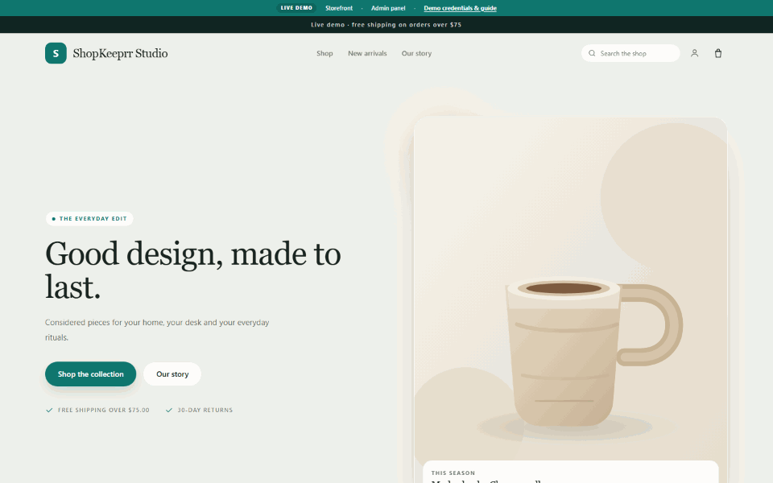
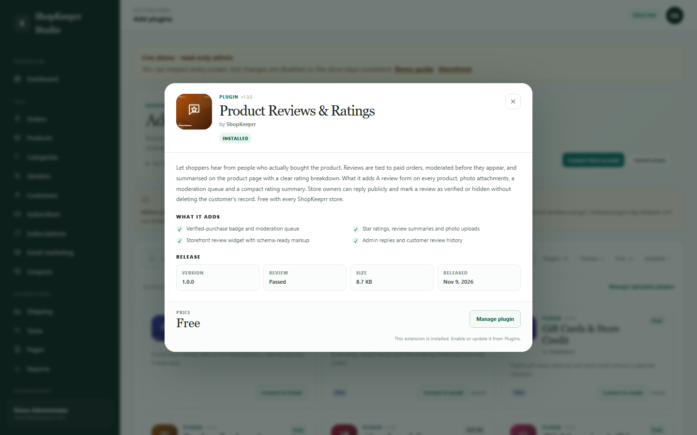
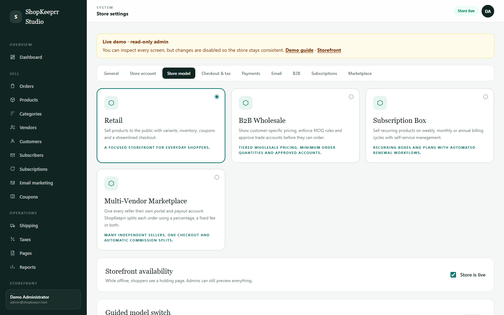

<p align="center">
  
</p>

<h1 align="center">ShopKeeprr</h1>

<p align="center"><strong>Self-hosted, four-mode commerce for Laravel.</strong><br>
Retail, B2B wholesale, subscriptions and multi-vendor — one admin, one checkout.</p>

<p align="center">
  <a href="https://demo.shopkeeprr.com/">
    
  </a>
</p>

<p align="center">
  <a href="https://demo.shopkeeprr.com/"><strong>Open the live demo →</strong></a><br>
  Admin: <code>admin@shopkeeprr.test</code> · Password: <code>ShopKeeprr2026!</code><br>
  <sub>Read-only demo · no setup or credit card needed</sub>
</p>

<p align="center">
  If ShopKeeprr is useful or you plan to try it, please
  <a href="https://github.com/DevByStephan/ShopKeeprr">give the repo a ⭐</a>
  — it helps other store owners find it.
</p>

---

## What is ShopKeeprr?

ShopKeeprr is a free, self-hosted commerce platform built on Laravel. The core
includes a storefront, admin workspace, retail/B2B/subscription/multi-vendor
store models, four storefront themes, a visual storefront builder, an extension
system and signed updates.

The application source lives on the [1.1 branch](https://github.com/DevByStephan/ShopKeeprr/tree/1.1).
This default branch is the public documentation and developer reference. The
complete package, including `vendor/`, is attached to the
[v1.1.0 GitHub Release](https://github.com/DevByStephan/ShopKeeprr/releases/tag/v1.1.0)
and available from [download.shopkeeprr.com](https://download.shopkeeprr.com/).
Extensions are distributed through [ShopKeeprr Store](https://store.shopkeeprr.com/).

**Current release:** 1.1.0 — free core<br>
**Stack:** Laravel 13 · PHP 8.3+ · MySQL 8 / SQLite · Vite · Tailwind CSS · Alpine.js

## Try it locally in 60 seconds

The quick-start downloads the released ZIP, switches the demo to SQLite, seeds
products, customers and orders, and starts the app. You need **PHP 8.3+ with
`pdo_sqlite`**, plus `curl` and `unzip`. No Composer, Node, MySQL or mail setup.

```bash
curl -fsSL https://raw.githubusercontent.com/DevByStephan/ShopKeeprr/main/quickstart.sh | bash
```

Open <http://127.0.0.1:8000> and sign in with:

```text
admin@shopkeeprr.test
ShopKeeprr2026!
```

Choose a different model or port without editing anything:

```bash
curl -fsSL https://raw.githubusercontent.com/DevByStephan/ShopKeeprr/main/quickstart.sh | SHOPKEEPRR_PORT=8081 SHOPKEEPRR_MODE=b2b bash
```

The supported models are `retail`, `b2b`, `subscription` and `multivendor`.
The quick-start is for local evaluation only; follow the
[installation guide](docs/installation.md) for production.

## A quick look

| In-app marketplace | Four store models |
| --- | --- |
|  |  |

The marketplace uses an in-page `<dialog>`, keeps the catalog and owned
extensions in one place, and installs approved plugins disabled until an
administrator enables them.

## What is new in 1.1

- Marketplace details open in a centered in-page `<dialog>`; no reload and no
  lost filters or scroll position.
- Store account linking from Admin → Marketplace with a one-time device code.
- Store catalog and the connected account's library appear in Admin.
- One-click installs verify the package SHA-256 checksum and install modules
  disabled until an administrator enables them.
- Manual ZIP upload remains available as the offline fallback.
- Marketplace scanner 1.1 keeps critical execution findings blocking while
  allowing lower-risk warnings, including console and command shell calls.
- The core is free at launch and is downloaded directly from shopkeeprr.com.

See [RELEASE-NOTES-1.1.0.md](RELEASE-NOTES-1.1.0.md) for the full release notes.

## Start here

| Guide | What it covers |
| --- | --- |
| [Installation](docs/installation.md) | Requirements, browser installer, CLI install, first-run cleanup |
| [Updating](docs/updates.md) | Signed updates, backups, rollback and staging |
| [Store models](docs/store-models.md) | Retail, wholesale, subscriptions and multi-vendor |
| [Storefront builder](docs/storefront-builder.md) | Blocks, drafts, previews and safe input |
| [Themes](docs/themes.md) | Presets, template resolution, custom themes and the template editor |
| [Modules](docs/modules.md) | Manifests, providers, routes, migrations and compatibility |
| [Marketplace](docs/marketplace.md) | Linking, one-click installs, listings, review and payouts |
| [Packaging releases](docs/releases.md) | Versioning, ZIP contents, scanning and private downloads |
| [Production checklist](docs/production.md) | HTTPS, database, mail, backups and go-live checks |
| [Troubleshooting](docs/troubleshooting.md) | Common installation, module, email and checkout issues |

The [Installation & FAQ PDF](ShopKeeprr-Installation-and-FAQ.pdf) is retained for
offline reference.

## Developer examples

- [Hello ShopKeeprr module](examples/plugin/hello-shopkeeprr/README.md) — a minimal, signed-in account page built as a module with a manifest, provider, route and Blade view.
- [Atelier Example theme](examples/theme/atelier-example/README.md) — a preset-style theme with palette metadata and storefront view overrides.

Examples are starting points. Test every extension on a staging store before
installing it on a live shop.

## Repository contents

```text
quickstart.sh         One-command SQLite demo setup
docs/                 Maintained Markdown reference
examples/plugin/      Minimal module template
examples/theme/       Minimal theme template
.github/              Issue and pull-request templates
SECURITY.md           Trust boundaries and vulnerability reporting
CONTRIBUTING.md       Documentation and example contribution rules
CHANGELOG.md          Public release history
```

## Release packages

The complete free core ZIP, including `vendor/`, is attached to the
[v1.1.0 GitHub Release](https://github.com/DevByStephan/ShopKeeprr/releases/tag/v1.1.0)
and available from [download.shopkeeprr.com](https://download.shopkeeprr.com/).
No `.env`, signing key, customer export or database file is published in this
repository.

Marketplace extension packages remain private to the Store and are delivered
through the customer's [ShopKeeprr Store account](https://store.shopkeeprr.com/).
Do not upload an application archive, an extension package, credentials or customer
data to GitHub.

## Support

- Store and account: <https://store.shopkeeprr.com/>
- Documentation site: <https://shopkeeprr.org/>
- Email: <info@shopkeeprr.com>
- Security reports: see [SECURITY.md](SECURITY.md)
- Optional tips: <https://buymeacoffee.com/devbystephan>

Tips are optional and do not purchase a license, priority support, or any feature.

## License

The free core application is governed by the license included with its download.
Documentation and example templates are provided under the terms in
[LICENSE](LICENSE).
